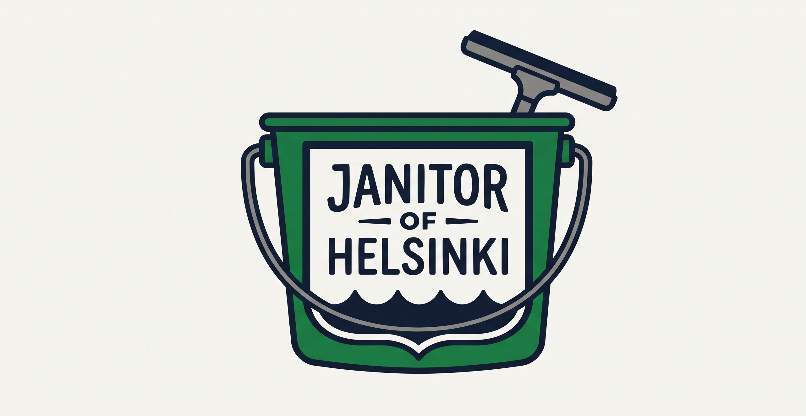

# Janitor of Helsinki

Rakastan Helsinkiä. Helsinki on kaunis, mielenkiintoinen ja monimuotoinen kaupunki. Kaupungilla liikkuessani tulee vastaan paikkoja jotka ovat unohdettuja ja huonossa kunnossa. Osa niistä ovat aiheutaa vain ärsytystä, mutta osa ovat potentiaalisesti vaarallisia kaupungin käyttäjille. Haluan meille kaikille parempaa Helsinki. Tämän projektin tavoitteena on antaa välineitä positiiviselle muutokselle elinympäristössämme.

## Inspiraatio

Projetktin inspiraationa toimi Laura Kampfin Janitor of LA -konsepti. Lisätietoja https://www.youtube.com/@laurakampf
